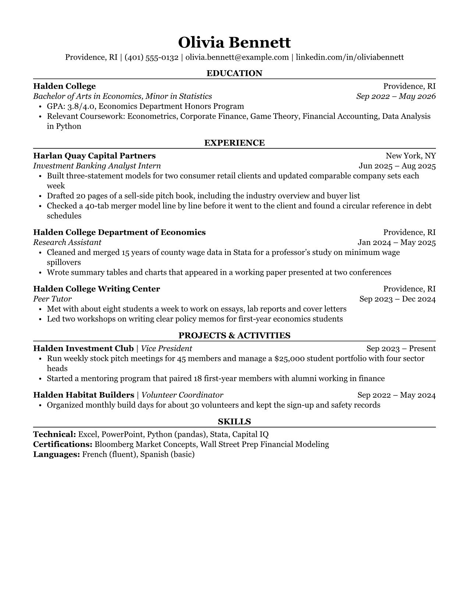

# Readable Resume Format

A one-page resume format for Quarto, typeset with Typst: serif type, centered
section headings over a thin rule, education first. It's the Classic template
from [ReadableResume](https://readableresume.com), where the same design is
available for Google Docs and Word.

Everything sits in one column with no tables, text boxes or icons, so the text
comes out of the PDF in reading order. That's the text applicant tracking
systems parse.

[](template.pdf)

## Installing

```bash
quarto use template supertj/quarto-readable-resume
```

This installs the extension and creates an example qmd file that you can use
as a starting place for your resume.

To add the format to an existing project or directory instead:

```bash
quarto add supertj/quarto-readable-resume
```

and set `format: readable-resume-typst` in the YAML header.

You need Quarto 1.7 or later. Typst comes bundled with Quarto, so there's
nothing else to install.

## Using

Your name and contact details go in the YAML header:

```yaml
---
name: Olivia Bennett
contact:
  - Providence, RI
  - (401) 555-0132
  - olivia.bennett@example.com
  - linkedin.com/in/oliviabennett
format: readable-resume-typst
---
```

The contact items are joined with vertical bars, and email and web addresses
become links.

Section headings are ordinary markdown headings and get set in capitals for
you. Each entry is a div with its details as attributes and the bullets inside:

```markdown
# Experience

::: {.experience
     company="Harlan Quay Capital Partners"
     location="New York, NY"
     title="Investment Banking Analyst Intern"
     date="Jun 2025 – Aug 2025"}
- Built three-statement models for two consumer retail clients
- Drafted 20 pages of a sell-side pitch book
:::
```

There are three kinds of entry:

| Div | Attributes | Layout |
|---|---|---|
| `.education` | `school`, `location`, `degree`, `date` | School and location on the first line, degree and dates in italics on the second. |
| `.experience` | `company`, `location`, `title`, `date` | Company and location first, then the job title in italics with the dates. |
| `.activity` | `name`, `role`, `date` | One line, "Name \| Role" with the dates on the right. For clubs, volunteering and projects. |

Every attribute is optional. Leave one out and it just isn't printed, and an
entry with no bullets is an empty div. A misspelled attribute name stops the
render with an "unknown argument" error instead of quietly disappearing.

For a skills section, end each line with a backslash so the lines stay apart:

```markdown
# Skills

**Technical:** Excel, PowerPoint, Python (pandas), Stata\
**Languages:** French (fluent), Spanish (basic)
```

A plain paragraph under a heading, such as a short summary, is set as body
text. [template.qmd](template.qmd) is a full one-page example.

## Options

| Option | Default | Notes |
|---|---|---|
| `papersize` | `us-letter` | `a4` works too. |
| `margin` | 0.6 in on US Letter, 15 mm on anything else | Takes the usual keys, e.g. `margin: {x: 0.75in, y: 0.6in}`. |
| `mainfont` | Georgia | Falls back to Libertinus Serif. |
| `fontsize` | `10.5pt` | The name and headings scale with it. |

## Fonts

The design uses Georgia, which comes with Windows and macOS, so on those
systems it looks exactly like the original with nothing to install. Where
Georgia isn't available, such as on Linux, Typst warns about the missing font
and falls back to Libertinus Serif, which ships with Typst. For something
closer to Georgia there, install Gelasio (free on Google Fonts, drawn to
Georgia's proportions) and set `mainfont: Gelasio`.

## License

MIT. The person, schools and companies in the sample are made up.
